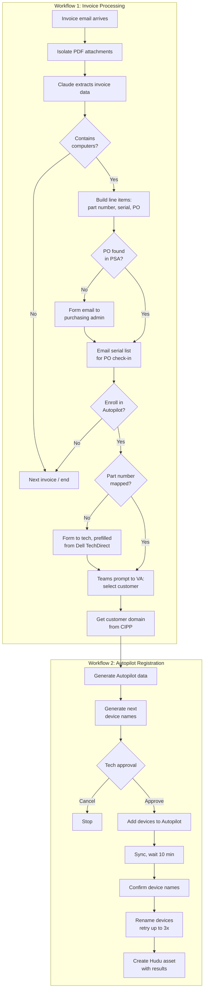
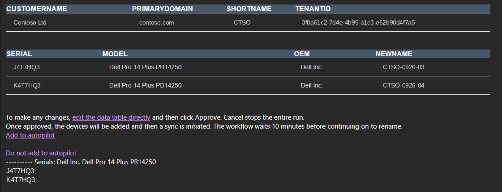

# Automated Device Provisioning: Invoice to Autopilot

Two linked workflows that take a hardware distributor invoice and turn it into fully registered, named, and documented Windows Autopilot devices, with human approval at the points that matter.

> **Results**
>
> - **Time:** Manual processing dropped by about **75%**. What used to take 45 to 60 minutes per device, before the device ever reached the user, is now a few approvals and form responses.
> - **Standardization:** Every device gets a standards-based name, the correct Autopilot registration, and a documentation record, no matter who handles the order.
> - **Accuracy:** Serial numbers, models, and PO numbers are pulled directly from the invoice, so nothing is hand-typed into Autopilot, the PSA, or the documentation platform.
> - **Drop-ship ready:** Combined with Intune and RMM policies, devices can ship straight to the end user and are ready for sign-in on first boot.

---

## Table of Contents

- [The Problem](#the-problem)
- [Tech Stack](#tech-stack)
- [Architecture](#architecture)
- [Workflow 1: Invoice Processing](#workflow-1-invoice-processing)
- [Workflow 2: Autopilot Registration](#workflow-2-autopilot-registration)
- [Design Decisions](#design-decisions)

---

## The Problem

Every new or replacement computer went through the same manual routine:

1. Create a PO and place the order
2. Receive the device and check it in against the PO
3. Unbox the device and power it on to capture the Autopilot hardware data
4. Register it in the customer's Autopilot tenant
5. Work out the next available device name and rename it
6. Ship or deliver it to the user
7. Document the device

That added up to 45 to 60 minutes per device before the user ever touched it, with plenty of room for typos in serial numbers, inconsistent names, and missed documentation.

---

## Tech Stack

| Layer | Tool | Role |
|---|---|---|
| Orchestration | **n8n** | Runs both workflows, approvals, forms, and the editable data table |
| Document extraction | Claude (Anthropic API) | Reads invoice PDFs and returns structured line-item data |
| PSA | Syncro | Purchase orders and PO check-in |
| Hardware data | Dell TechDirect API | Maps part numbers to device models |
| Mapping store | SharePoint list | Part number to Autopilot model mapping |
| M365 management | CIPP | Customer tenant lookups and Autopilot registration |
| Endpoint management | Windows Autopilot, Intune | Device registration, renaming, and policy deployment |
| Documentation | Hudu | Device asset records and provisioning results |
| Notifications | Email, Microsoft Teams | Approvals, forms, and prompts |

---

## Architecture

---

## Workflow 1: Invoice Processing

### 1. Extract the invoice

When a distributor invoice arrives by email, the workflow isolates every PDF attachment and sends each one to Claude for data extraction. Claude first determines whether the invoice contains computers at all; distributor invoices also include accessories, infrastructure, and warranties, which are skipped.

For invoices with computers, Claude returns a structured list of line items with the **part number, serial number, and PO number** for each device.

### 2. Match the purchase order

The workflow looks up the PO in the PSA. If it can't be found, the purchasing admin receives a form email to supply it, so no device moves forward without a matching PO.

### 3. PO check-in

A ready-to-paste list of serial numbers is emailed to the team for bulk check-in against the PO, replacing manual serial entry.

### 4. Decide on Autopilot enrollment

The technician is asked whether these devices should be enrolled in Autopilot. If not, the workflow moves on to the next invoice.

### 5. Map the part number to a model

Autopilot needs the device model, but invoices only list the distributor part number. The workflow checks a part-number-to-model mapping list. If the part number is new, the technician receives a form to add it, **prefilled with the model from Dell TechDirect** when available. Each mapping only has to be confirmed once.

### 6. Select the customer

The virtual assistant receives a Teams message, with a link to the PO, asking which customer the devices belong to. The workflow then pulls that customer's default domain from CIPP and hands the devices to the Autopilot workflow.  

---

## Workflow 2: Autopilot Registration

### 1. Generate Autopilot data and device names

The workflow builds the Autopilot registration data for each device and generates its name using the standard `SHORTNAME-MMYY-NN` format.

To find the next available number, it pulls **every existing device** for the customer, both Autopilot registrations and devices already in use, checks for names that already use the current month and year, and increments from the highest one.

### 2. Approval

The technician receives an approval email showing the customer, tenant, and every device with its serial number, model, and new name. Any value can be corrected in the underlying data table before approving.

### 3. Register and rename

Once approved, the workflow:

- Adds the devices to the customer's Autopilot tenant
- Triggers an Autopilot sync and waits 10 minutes for registration to finish
- Sends a form to confirm the final device names
- Renames each device, waiting 5 minutes and retrying up to 3 times if a rename fails

### 4. Document

A Hudu asset is created for each device, and the Autopilot and rename results are written to the asset notes, so every device has a documentation record from day one.

---

## Design Decisions

**Why use an LLM for invoice parsing?** Distributor invoices vary in layout and mix computers with accessories, warranties, and other hardware. An LLM handles that variation and makes the "does this invoice contain computers?" judgment, where template-based parsing would break whenever the layout changed.

**Why a self-maintaining mapping list?** Part numbers change constantly as models are refreshed. Instead of maintaining the list by hand, the workflow asks for a mapping only when it sees a new part number and prefills the answer from Dell TechDirect, so the list grows as a byproduct of normal work.

**Why human approval before registration?** Registering a device in the wrong customer's tenant is costly to undo. A single approval step, with the full data in front of the technician and the option to edit it, catches mistakes before anything changes in the tenant.

